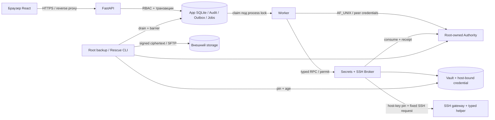

# Архитектурный разбор

База и ограничения — в [общем отчёте](AUDIT_REPORT.md). Оценка относится к development-реализации на `034ed1d6`, а не к готовому MVP.

## Текущие компоненты

Разделение процессов соответствует самостоятельным границам: API не должен читать Vault или обращаться к Broker socket; Worker не должен самостоятельно выпускать разрешение; Broker не принимает произвольную команду; Gate — host-local и отделён от заменяемого Backend. Эти границы не делают Backend недоверенным источником авторизации: ТЗ §31 прямо относит Backend к TCB.

## Сквозные потоки

**Наблюдение.** Сессия и RBAC → атомарный Job + Audit/Outbox → один Worker с lifetime lock → permit host authority → Broker проверяет scope/secret → SSH с закреплённым ключом и фиксированным helper → receipt → Job/Audit → инвентарь. Потерянный ответ после отправки не превращается в успех и не переисполняется автоматически. Текущий единственный adapter — read-only probe; preview перезапуска не выполняет изменение.

**Восстановление.** Координатор закрывает приём business writers, ждёт drain и фиксирует snapshot под ограниченным barrier; после снятия барьера данные шифруются и подписываются. Публикация проверяет копию на SFTP; offline Rescue проверяет происхождение, расшифровывает в памяти и готовит одноразовый пакет для новой системы. Импорт не активирует mutations: нужна отдельная ручная изоляция старого Controller и локальная активация.

## Критическая оценка

1. **Сохранить монолитный control plane и один SQLite.** Это явно соответствует ТЗ, заявленной single-active модели и масштабу до 25 VPS. Текущий индекс истории нужно измерить и, при необходимости, улучшить (AUD-06), но переход на PostgreSQL, внешний брокер или микросервисы не обоснован. ТЗ §37 требует отдельного capacity review при превышении порогов, а не автоматической миграции.
2. **Сохранить отдельные Gate и Broker.** Здесь дополнительные процессы защищают разные ключи и операции; объединение в FastAPI упростит код ценой потери изоляции. Однако независимое подтверждение пользователя они не дают: Backend с записью в авторитетную БД остаётся TCB. Нельзя рекламировать их как защиту от любых действий скомпрометированного Backend.
3. **Исправить контракты на стыках, прежде чем наращивать managers.** Восстановление меняет Job без завершения его Timeline (AUD-04); допустимый архив может не помещаться в Rescue (AUD-02); время публикации не соответствует возможному объёму (AUD-05). Это важнее косметического дробления классов.
4. **Не выдавать лабораторный прототип за production runtime.** Stage0 содержит отдельные реализации и стенды, а не замену runtime. Уже принятые evidence сохраняются. Foundation и Stage2 описывают ограниченные рабочие части; A/B update, production mutation, полный набор adapters и независимая DR-приёмка не подтверждены.
5. **Не расширять права из preview.** Текущая проверка restart-preview — только снимок. Для apply потребуются неизменяемый plan/approval, fresh preflight/CAS, Backup Gate, полная проверка delegated Docker effect и incident reconciliation согласно ТЗ §§32–36, 40.
6. **Минимизировать связанность без нового framework.** Контракты `Store`, queue и audit events уже общие для runtime и recovery; при добавлении переходов использовать один проверяемый транзакционный путь или явно описанный импортный вариант. Не делать новую универсальную платформу адаптеров до первого рабочего end-to-end сценария.

## Целевая архитектура к Stage3

Схема выше сохраняется; добавляются логические, а не обязательно процессные, части: versioned Change Plan + approval, единый operations manager, проверка Backup Gate, реальный typed adapter с remote ledger и reconciliation, наблюдаемость, жизненный цикл хранилища и проверенная матрица совместимости. Каждая часть сначала поставляется для одного ограниченного Docker restart, не как общий движок всех будущих действий.

**Решение:** до Stage3 нужен поэтапный архитектурный рефакторинг границ и контрактов, но не замена архитектуры целиком. Достаточность подтверждается сквозными fault-injection испытаниями и capacity §37, которых сейчас нет. Подробные условия — [roadmap](REFACTORING_ROADMAP.md).
